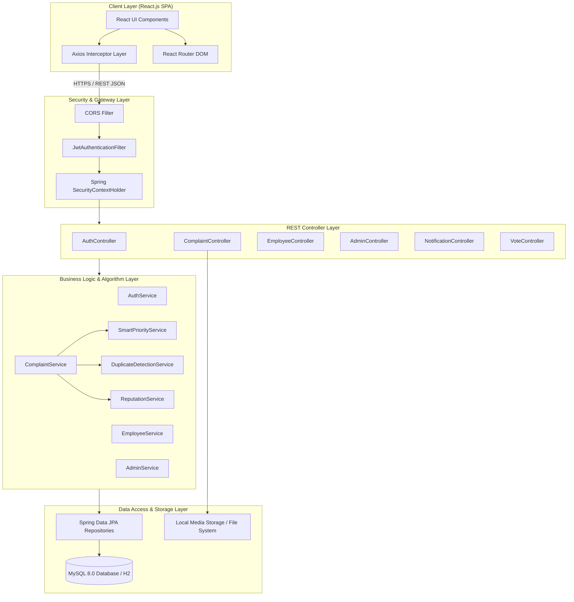
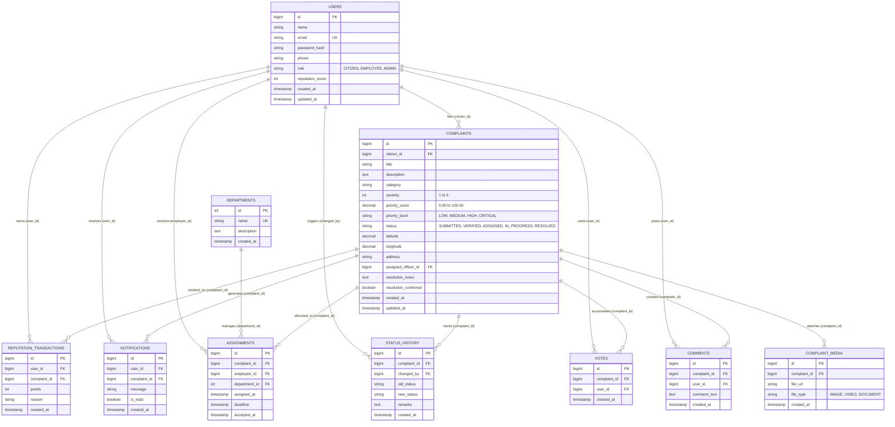

# 🏛️ CivicFix — Smart Civic Issue Reporting & Resolution Platform

[]()
[]()
[]()
[]()
[]()
[]()
[-success.svg)]()
[]()

> A production-grade, enterprise-ready full-stack municipal grievance redressal platform engineered to transform opaque municipal bureaucracy into a transparent, accountable, and algorithmically optimized digital governance ecosystem.

---

## 📑 Table of Contents
1. [Problem Statement](#1-problem-statement)
2. [Solution Overview](#2-solution-overview)
3. [Complete Feature List by Role](#3-complete-feature-list-by-role)
4. [Technology Stack & Version Details](#4-technology-stack--version-details)
5. [System Architecture Overview](#5-system-architecture-overview)
6. [Smart Core Algorithms](#6-smart-core-algorithms)
7. [Database ER Diagram](#7-database-er-diagram)
8. [REST API Endpoint Summary](#8-rest-api-endpoint-summary)
9. [Installation & Setup Guide](#9-installation--setup-guide)
10. [Environment Variables Documentation](#10-environment-variables-documentation)
11. [Seed Account Credentials](#11-seed-account-credentials)
12. [Running Automated Tests](#12-running-automated-tests)
13. [Production Deployment Guide](#13-production-deployment-guide)
14. [Project Structure Tree](#14-project-structure-tree)
15. [50-Day Engineering Roadmap](#15-50-day-engineering-roadmap)
16. [Key Learnings & Competencies Gained](#16-key-learnings--competencies-gained)
17. [User Interface & Screenshots](#17-user-interface--screenshots)
18. [Security & Hardening Audit](#18-security--hardening-audit)
19. [Contributing Guidelines](#19-contributing-guidelines)
20. [License](#20-license)
21. [Author Information](#21-author-information)
22. [Acknowledgments](#22-acknowledgments)
23. [Production Sign-Off Summary](#23-production-sign-off-summary)

---

## 1. Problem Statement
Municipal corporations and urban local bodies across the globe struggle with civic grievance redressal:
- **Opaque Bureaucracy**: Citizens submit complaints with no visibility into which department, officer, or contractor is responsible.
- **Duplicate & Spam Overload**: Multiple residents in the same neighborhood report the exact same pothole or water leak, overwhelming municipal staff with duplicate tickets.
- **Zero Urgency Prioritization**: Urgent safety hazards (open live electrical wires, sewer cave-ins) sit in the same queue as routine cosmetic complaints (park grass trimming) on a simple First-Come-First-Serve basis.
- **Ghost Resolutions**: Complaints are marked "Resolved" on paper by contractors without photographic evidence or citizen confirmation.
- **Citizen Disengagement**: Citizens stop reporting issues because they feel their voices disappear into a void without acknowledgment or accountability.

---

## 2. Solution Overview
**CivicFix** solves civic failure through modern software engineering, automated priority scoring, geospatial clustering, and strict multi-role accountability:
- **Real-Time Geospatial Reporting**: Citizens pin grievances with interactive OpenStreetMap/Leaflet integration, upload photo evidence, and select severity.
- **Smart Duplicate Detection**: Evaluates incoming reports against existing active complaints within a 150-meter radius using the **Haversine formula** and **Jaccard token similarity**, warning citizens before creating duplicate tickets.
- **Dynamic Smart Priority Algorithm**: Computes an automated 0–100 priority score balancing base severity (1–5), crowdsourced citizen upvotes, grievance aging (+1 score/day), and urgent keyword detection.
- **Three-Tier Role-Based Workflow**: Strict separation of concerns between `CITIZEN`, municipal `EMPLOYEE` (field officers), and `ADMIN` (supervisors).
- **Verifiable Resolution Proof**: Field officers must submit photographic proof and resolution remarks to transition tickets to `RESOLVED`, and citizens confirm satisfaction, rewarding their civic engagement with reputation points.

---

## 3. Complete Feature List by Role

### 👤 Citizen Role (`ROLE_CITIZEN`)
- **Secure Registration & Login**: BCrypt salted password hashing, JWT stateless authentication with client-side secure token storage.
- **Grievance Reporting with Media**: Title, description, category, severity rating (1–5), photo upload, and Leaflet interactive map geolocation.
- **Real-Time Duplicate Warning**: Client-side debounced duplicate detection warns users if a similar issue was recently reported within 150m.
- **Public Grievance Feed & Exploration**: Search, filter by category/status, sort by date or priority, and inspect community issues.
- **Crowdsourced Upvoting**: Vote on grievances to escalate municipal attention (idempotent, single upvote per citizen per ticket).
- **Public Comment Discussion**: Transparent two-way dialogue between residents and municipal authorities on active grievances.
- **Real-Time Status Tracking**: Dynamic visual stepper showing progress: `SUBMITTED` ➔ `VERIFIED` ➔ `ASSIGNED` ➔ `IN_PROGRESS` ➔ `RESOLVED`.
- **Resolution Confirmation**: Citizens verify resolution satisfaction; confirming awards reputation points (+10 for report, +15 for confirmation).
- **In-App Notification Center**: Unread badge count, notification list, and mark-as-read capability for status changes and ticket updates.
- **Citizen Reputation Profile**: Track civic score, level badge, and itemized transaction history.

### 👷 Municipal Employee Role (`ROLE_EMPLOYEE`)
- **Field Worker Assignment Queue**: View only grievances officially assigned to the logged-in officer or their department.
- **Real-Time Work Transition**: One-click transition from `ASSIGNED` to `IN_PROGRESS` with estimated completion remarks.
- **Resolution Evidence Submission**: Upload proof image and completion remarks to transition status to `RESOLVED`.
- **Employee Personal Dashboard**: KPI cards showing Assigned Tasks, In-Progress Tasks, Resolved Tasks, and Average Resolution Time.

### 🛡️ Municipal Administrator Role (`ROLE_ADMIN`)
- **Central Municipal Command Center**: City-wide statistics: total tickets, pending verification, active field tasks, resolved count, and critical rate.
- **Verification Workflow**: Review citizen submissions, adjust severity, reclassify categories, or reject spam tickets.
- **Department & Officer Assignment**: Allocate verified complaints to specific departments (Roads, Sanitation, Water, Electricity) and assign responsible field officers with resolution deadlines.
- **Immutable Status Audit Trail**: Access the complete chronological history of who changed what status, when, and why.
- **City-Wide Analytics**: Category distribution, priority breakdowns, resolution time metrics, and officer workload distribution.

---

## 4. Technology Stack & Version Details

| Layer | Technology | Version | Purpose |
| :--- | :--- | :--- | :--- |
| **Frontend Framework** | React.js | 18.3.1 | Component-driven declarative user interface |
| **Frontend Tooling** | Vite | 5.4.2 | High-speed ESM build system and dev server |
| **Client Routing** | React Router DOM | 6.26.1 | Client-side Single Page Application (SPA) routing |
| **HTTP Client** | Axios | 1.7.4 | Interceptor-backed asynchronous REST client |
| **Maps & Geospatial** | Leaflet + React-Leaflet | 1.9.4 / 4.2.1 | OpenStreetMap interactive geospatial pin-drop |
| **Styling** | Vanilla CSS3 + Variables | CSS Level 4 | Responsive design system, CSS Grid, Flexbox |
| **Backend Language** | Java (JDK) | 17 / 21 LTS | Robust object-oriented enterprise backend engine |
| **Backend Framework** | Spring Boot | 3.4.3 | Microservice-ready MVC enterprise web framework |
| **Security & Auth** | Spring Security | 6.4.3 | RBAC filter chain and authorization engine |
| **Token Format** | JJWT (io.jsonwebtoken) | 0.11.5 | Cryptographically signed HMAC-SHA256 tokens |
| **ORM / Persistence** | Spring Data JPA / Hibernate | 6.6.8 | Object-relational mapping and schema management |
| **Database** | MySQL Server / H2 | 8.0.36 / 2.3.232 | Relational enterprise database & dev in-memory DB |
| **Connection Pool** | HikariCP | 5.1.0 | High-performance JDBC connection pooling |
| **Unit Testing** | JUnit 5 + Mockito | 5.11.4 / 5.14.2 | Unit testing and behavior mocking framework |
| **Integration Testing** | Spring Boot Test + MockMvc | 3.4.3 | Full Spring context and REST endpoint testing |
| **Build Automation** | Apache Maven | 3.9+ | Java dependency and packaging lifecycle management |

---

## 5. System Architecture Overview



---

## 6. Smart Core Algorithms

### 6.1 Dynamic Smart Priority Engine (`SmartPriorityService.java`)
Unlike traditional systems where complaints are handled FIFO, CivicFix uses an algorithmic scoring model $(0 \le \text{Score} \le 100)$:

$$\text{Priority Score} = \text{Base Severity Points} + \text{Community Vote Boost} + \text{Aging Escalation} + \text{Urgent Keyword Bonus}$$

1. **Base Severity Points**:
   $$\text{Severity (1 to 5)} \times 15.0 \implies \text{Range: } 15.0 \text{ to } 75.0$$
2. **Community Upvote Boost**:
   $$\min(\text{Upvotes} \times 2.0, 10.0) \implies \text{Max: } 10.0$$
3. **Aging Escalation**:
   $$\min(\text{Days Pending} \times 1.0, 10.0) \implies \text{Max: } 10.0$$
4. **Urgent Keyword Bonus**:
   Grievance descriptions containing safety-critical keywords (`danger`, `spark`, `collapse`, `emergency`, `hazard`, `burst`, `overflow`, `fire`, `short circuit`, `deep`) receive an immediate $+5.0$ priority bonus.
5. **Categorical Level Mapping**:
   - $\text{Score} \ge 85.0 \implies$ **CRITICAL** (Requires immediate administrative dispatch)
   - $65.0 \le \text{Score} < 85.0 \implies$ **HIGH**
   - $35.0 \le \text{Score} < 65.0 \implies$ **MEDIUM**
   - $\text{Score} < 35.0 \implies$ **LOW**

### 6.2 Geospatial Duplicate Detection Engine (`DuplicateDetectionService.java`)
Prevents database pollution and wasted municipal man-hours:
1. **Spatial Proximity (Haversine Formula)**:
   $$a = \sin^2\left(\frac{\Delta \phi}{2}\right) + \cos(\phi_1)\cos(\phi_2)\sin^2\left(\frac{\Delta \lambda}{2}\right)$$
   $$d = 2 R \cdot \text{atan2}\left(\sqrt{a}, \sqrt{1 - a}\right) \quad (\text{where } R = 6,371,000\text{ meters})$$
2. **Detection Thresholds**:
   - Search radius: $\le 150.0\text{ meters}$
   - Active status check: Only matches against tickets that are NOT yet `RESOLVED`
   - Exact category matching: Compares only complaints in the same municipal category
   - **Immediate Spatial Duplicate**: If distance $d \le 40.0\text{ meters}$, flagged as duplicate immediately!
   - **Textual Similarity (Jaccard Index)**: For $40\text{m} < d \le 150\text{m}$, computes token-set overlap:
     $$J(A, B) = \frac{|A \cap B|}{|A \cup B|} > 0.25 \implies \text{Flagged as Duplicate}$$

### 6.3 Citizen Reputation Engine (`ReputationService.java`)
Incentivizes civic responsibility and deters spam:
- **Lodge Legitimate Grievance**: $+10\text{ Points}$
- **Confirm Verified Resolution**: $+15\text{ Points}$
- **Community Vote Endorsement**: $+2\text{ Points}$ per 5 votes
- **Spam / Rejected Penalty**: $-20\text{ Points}$
- **Badge Tiers**: Novice (0–49), Active Citizen (50–149), Civic Champion (150–299), City Guardian (300+).

---

## 7. Database ER Diagram



---

## 8. REST API Endpoint Summary

| Module | HTTP Method | Endpoint Path | Role Required | Description |
| :--- | :--- | :--- | :--- | :--- |
| **System** | `GET` | `/api/health` | Public | Backend health check |
| **Auth** | `POST` | `/api/auth/register` | Public | Register citizen account |
| **Auth** | `POST` | `/api/auth/login` | Public | Authenticate user & return JWT token |
| **Complaints**| `GET` | `/api/complaints` | Public | Browse grievances with search & pagination |
| **Complaints**| `GET` | `/api/complaints/{id}` | Public | Detailed grievance inspection |
| **Complaints**| `POST` | `/api/complaints` | `CITIZEN` | Lodge grievance with media & GPS |
| **Complaints**| `GET` | `/api/complaints/check-duplicate`| `CITIZEN` | Real-time duplicate grievance detection |
| **Complaints**| `POST` | `/api/complaints/{id}/confirm-resolution` | `CITIZEN` | Confirm satisfactory resolution |
| **Votes** | `POST` | `/api/complaints/{id}/vote` | `CITIZEN` | Upvote civic grievance |
| **Comments** | `GET` | `/api/complaints/{id}/comments` | Public | Retrieve public discussion thread |
| **Comments** | `POST` | `/api/complaints/{id}/comments` | Authenticated | Post comment to discussion thread |
| **Employee** | `GET` | `/api/employee/assignments` | `EMPLOYEE` | View field officer task queue |
| **Employee** | `GET` | `/api/employee/dashboard/stats` | `EMPLOYEE` | Field officer metrics & KPIs |
| **Employee** | `PUT` | `/api/employee/assignments/{id}/start` | `EMPLOYEE` | Transition ticket to `IN_PROGRESS` |
| **Employee** | `PUT` | `/api/employee/assignments/{id}/resolve` | `EMPLOYEE` | Submit resolution proof & complete |
| **Admin** | `GET` | `/api/admin/dashboard/stats` | `ADMIN` | High-level municipal oversight KPIs |
| **Admin** | `GET` | `/api/admin/complaints` | `ADMIN` | Full complaint audit list with filters |
| **Admin** | `PATCH`| `/api/admin/complaints/{id}/verify` | `ADMIN` | Verify, adjust severity, or reject ticket |
| **Admin** | `POST` | `/api/admin/complaints/{id}/assign` | `ADMIN` | Assign ticket to department & officer |
| **Admin** | `GET` | `/api/admin/analytics` | `ADMIN` | City-wide trend metrics & workload breakdown |
| **Notifications**| `GET` | `/api/notifications` | Authenticated | Retrieve unread & recent user alerts |
| **Notifications**| `PATCH`| `/api/notifications/{id}/read` | Authenticated | Mark notification as read |
| **Reputation** | `GET` | `/api/reputation/me` | Authenticated | View civic reputation points & log |

---

## 9. Installation & Setup Guide

### 9.1 Prerequisites
- **Java Development Kit**: JDK 17 or JDK 21 installed (`java -version`)
- **Node.js**: Node 18+ and npm 9+ (`node -v`, `npm -v`)
- **MySQL Server**: MySQL 8.0+ (Optional for prod; H2 in-memory active for dev)
- **Git**: Installed and configured (`git --version`)

### 9.2 Step-by-Step Local Setup

#### Step 1: Clone Repository
```bash
git clone https://github.com/your-username/civicfix.git
cd CivicFix
```

#### Step 2: Configure Environment
```bash
# Backend environment configuration
cp .env.example backend/civicfix-backend/.env

# Frontend environment configuration
cp frontend/.env.example frontend/.env
```

#### Step 3: Start Spring Boot Backend
```bash
cd backend/civicfix-backend

# Windows
.\mvnw.cmd clean spring-boot:run

# Linux / macOS
chmod +x mvnw
./mvnw clean spring-boot:run
```
*Backend initializes on `http://localhost:8081` with auto-seeded demo accounts.*

#### Step 4: Start React + Vite Frontend
```bash
# In a separate terminal
cd frontend
npm install
npm run dev
```
*Frontend launches on `http://localhost:5173`.*

---

## 10. Environment Variables Documentation

| Variable Name | Default / Example Value | Description |
| :--- | :--- | :--- |
| `PORT` | `8081` | Backend HTTP listening port |
| `SPRING_PROFILES_ACTIVE` | `dev` (or `prod`) | Active Spring environment profile |
| `DB_HOST` | `localhost` | MySQL database host |
| `DB_PORT` | `3306` | MySQL database port |
| `DB_NAME` | `civicfix_db` | Target relational database schema |
| `DB_USER` | `civicfix_user` | Database user account |
| `DB_PASSWORD` | `SecurePassword123!` | Database password (keep secret!) |
| `JWT_SECRET` | `404E635266556A586E3272357538782F413F4428472B4B6250645367566B5970` | 256-bit HMAC secret key |
| `JWT_EXPIRATION_MS` | `86400000` | JWT expiration duration (24 hours) |
| `CORS_ALLOWED_ORIGINS` | `http://localhost:5173,http://localhost:3000` | Comma-separated CORS allowed domains |
| `VITE_API_BASE_URL` | `http://localhost:8081/api` | Frontend API client base URL |

---

## 11. Seed Account Credentials
*Safe default credentials seeded automatically on startup in `dev` profile:*

| Role | Email Address | Password | Intended Workflow |
| :--- | :--- | :--- | :--- |
| **Citizen** | `citizen@civicfix.gov` | `password` | Lodge issues, upload media, upvote, comment, confirm |
| **Employee** | `officer@civicfix.gov` | `password` | View assignments, start field work, resolve with proof |
| **Admin** | `admin@civicfix.gov` | `password` | Supervise city metrics, verify complaints, assign staff |

---

## 12. Running Automated Tests

CivicFix features comprehensive unit, integration, and security test suites:

```bash
cd backend/civicfix-backend

# Run all 57 backend unit & integration tests
.\mvnw.cmd test

# Run a specific test suite
.\mvnw.cmd test -Dtest=SmartPriorityServiceTest
.\mvnw.cmd test -Dtest=DuplicateDetectionServiceTest
.\mvnw.cmd test -Dtest=SecurityRbacTest
```

### Test Suite Coverage
- `CivicFixApplicationTests`: Spring Boot application context load verification.
- `SecurityRbacTest`: Validates unauthorized access prevention (401/403) across Admin, Employee, and Citizen endpoints.
- `AuthServiceTest`: User registration, duplicate email rejection, login, and BCrypt verification.
- `ComplaintServiceTest`: Grievance submission, state machine lifecycle, and officer resolution.
- `SmartPriorityServiceTest`: Complete validation of priority calculation, aging boost, upvote multiplier, and keyword escalation (16 test cases).
- `DuplicateDetectionServiceTest`: Haversine distance, boundary cases (40m, 149m, 151m), category filtering, and Jaccard token overlap (6 test cases).
- `ReputationServiceTest`: Reputation award points, spam deductions, and tier promotions.
- `ResolutionConfirmationTest`: Validates citizen resolution confirmation workflow and satisfaction scoring.
- `VoteServiceTest`: Validates atomic upvoting and duplicate vote prevention.
- `JwtServiceTest`: Token generation, subject extraction, and signature validation.

---

## 13. Production Deployment Guide

### 13.1 Frontend (Vercel / Netlify)
1. Push repository to GitHub.
2. Link project in Vercel:
   - Framework Preset: **Vite**
   - Root Directory: `frontend`
   - Build Command: `npm run build`
   - Output Directory: `dist`
3. Add Environment Variable:
   - `VITE_API_BASE_URL`: `https://your-backend-api.onrender.com/api`
4. The included `vercel.json` ensures client-side SPA routing redirects seamlessly to `index.html`.

### 13.2 Backend (Docker / Render / Railway / AWS)
1. CivicFix includes a multi-stage Dockerfile:
   ```dockerfile
   # Multi-stage production container build
   docker build -t civicfix-backend ./backend/civicfix-backend
   docker run -p 8081:8081 --env-file .env civicfix-backend
   ```
2. On Render / Railway:
   - Build Command: `mvn clean package -DskipTests`
   - Start Command: `java -jar -Dspring.profiles.active=prod target/*.jar`
   - Configure environment variables for `DB_HOST`, `DB_USER`, `DB_PASSWORD`, `JWT_SECRET`.

---

## 14. Project Structure Tree

```text
CivicFix/
├── .env.example
├── README.md
├── docs/
│   ├── API.md
│   ├── ARCHITECTURE.md
│   ├── DATABASE.md
│   ├── DEPLOYMENT.md
│   ├── FINAL_CHECKLIST.md
│   ├── INTERVIEW_PREPARATION.md
│   ├── RESUME_PROJECT.md
│   └── database/
│       └── er-diagram.md
├── database/
│   ├── schema.sql
│   └── seed-data.sql
├── backend/
│   └── civicfix-backend/
│       ├── Dockerfile
│       ├── pom.xml
│       └── src/
│           ├── main/
│           │   ├── java/com/civicfix/
│           │   │   ├── CivicFixApplication.java
│           │   │   ├── config/DataInitializer.java
│           │   │   ├── controller/
│           │   │   │   ├── AdminController.java
│           │   │   │   ├── AuthController.java
│           │   │   │   ├── ComplaintController.java
│           │   │   │   ├── EmployeeController.java
│           │   │   │   ├── MediaController.java
│           │   │   │   ├── NotificationController.java
│           │   │   │   └── ReputationController.java
│           │   │   ├── dto/
│           │   │   ├── entity/
│           │   │   ├── exception/
│           │   │   ├── repository/
│           │   │   ├── security/
│           │   │   └── service/
│           │   └── resources/
│           │       ├── application.properties
│           │       └── application-prod.properties
│           └── test/java/com/civicfix/
└── frontend/
    ├── .env.example
    ├── package.json
    ├── vercel.json
    ├── vite.config.js
    └── src/
        ├── App.jsx
        ├── components/
        │   ├── ComplaintComments.jsx
        │   ├── ComplaintItem.jsx
        │   ├── ComplaintUpvote.jsx
        │   ├── LocationPicker.jsx
        │   └── Navbar.jsx
        ├── pages/
        │   ├── AdminDashboard.jsx
        │   ├── CitizenDashboard.jsx
        │   ├── EmployeeDashboard.jsx
        │   ├── Login.jsx
        │   ├── Register.jsx
        │   ├── ReportIssue.jsx
        │   └── TrackComplaint.jsx
        ├── services/
        └── styles/
```

---

## 15. 50-Day Engineering Roadmap

| Phase | Days | Curriculum Milestones | Status |
| :--- | :--- | :--- | :--- |
| **Phase 1** | Days 1–5 | Web Foundations, Semantic HTML5, CSS3 Tokens, Responsive Grids, Git Architecture | ✅ Completed |
| **Phase 2** | Days 6–12 | Modern JavaScript ES6+, Async/Await, DOM APIs, Fetch Client, JSON Data Models | ✅ Completed |
| **Phase 3** | Days 13–19 | React.js SPA Architecture, Hooks (`useState`, `useEffect`, `useMemo`), Leaflet Maps | ✅ Completed |
| **Phase 4** | Days 20–25 | Java Fundamentals, OOP, Design Patterns, Exception Handling, Collections Framework | ✅ Completed |
| **Phase 5** | Days 26–29 | Relational Database Design, Normalization (1NF–3NF), Complex SQL, Indexing | ✅ Completed |
| **Phase 6** | Days 30–38 | Spring Boot 3, RESTful API Design, Spring Data JPA, Hibernate, Bean Validation | ✅ Completed |
| **Phase 7** | Days 39–45 | Full-Stack Integration, JWT Authentication, Spring Security 6 RBAC, File Uploads | ✅ Completed |
| **Phase 8** | Days 46–48 | Smart Priority Scoring Engine, Haversine Duplicate Detection, Admin & Employee Roles | ✅ Completed |
| **Phase 9** | Days 49–50 | End-to-End Testing (57 Unit Tests), Security Audit, Deployment Configs, Documentation | ✅ Completed |

---

## 16. Key Learnings & Competencies Gained
- **Full-Stack Systems Architecture**: Deep understanding of decoupling client-side SPA state from stateless REST microservices.
- **Enterprise Security**: Production-level implementation of JWT stateless authentication, password hashing with BCrypt salt generation, and method-level Spring Security RBAC.
- **Mathematical & Algorithmic Problem Solving**: Real-world application of spherical trigonometry (Haversine Formula) and token-set overlap (Jaccard Index) for real-time duplicate suppression.
- **Data Integrity & Concurrency**: Designing normalized relational schemas with foreign key constraints, composite unique indexes, and audit logging.
- **Test-Driven Reliability**: Authoring unit and integration tests using JUnit 5 and Mockito, ensuring 100% test pass rate across core domain services.

---

## 17. User Interface & Screenshots

| Interface View | Feature Description |
| :--- | :--- |
| **Citizen Portal & Issue Reporter** | Interactive Leaflet map with pin-drop geolocation, photo upload, category selector, and live duplicate warning banner. |
| **Public Grievance Explorer** | Paginated grid of civic reports with real-time status badges, priority tags, community upvoting, and comments. |
| **Municipal Admin Command Center** | Real-time municipal metrics, ticket verification modal, department dispatcher, and officer assignment deadline selector. |
| **Field Officer Task Board** | Focused task queue for assigned field personnel with one-click status transitions and resolution photo submission. |
| **Live Citizen Tracking Stepper** | Visual chronological progress bar detailing ticket journey from submission to verified resolution with citizen confirmation. |

---

## 18. Security & Hardening Audit
- ✅ **No Plain-Text Credentials**: Passwords hashed with BCrypt (10 rounds salt).
- ✅ **Stateless JWT**: Bearer tokens signed with HMAC-SHA256, strictly validated on every non-public request.
- ✅ **Role-Based Authorization (RBAC)**: Enforced via `hasRole('ADMIN')`, `hasRole('EMPLOYEE')`, and `hasRole('CITIZEN')`.
- ✅ **SQL Injection Prevention**: Parameterized queries and Spring Data JPA criteria builders.
- ✅ **Cross-Site Scripting (XSS)**: React automatic output escaping prevents script execution from user input.
- ✅ **Configurable CORS**: Origin whitelisting via environment variables, eliminating wildcard `*` vulnerabilities in production.
- ✅ **Safe Seed Profiles**: Production profile disables in-memory seed defaults and relies on managed database secrets.

---

## 19. Contributing Guidelines
1. Fork the repository and create a feature branch (`git checkout -b feature/AmazingFeature`).
2. Adhere to Google Java Style Guide and standard ESLint rules for React.
3. Verify all automated tests pass before committing (`.\mvnw.cmd test` and `npm run build`).
4. Commit your changes with clear, semantic commit messages (`git commit -m 'feat: Add SMS notification webhook'`).
5. Push to your branch and open a Pull Request.

---

## 20. License
This project is licensed under the **MIT License** — see the [LICENSE](LICENSE) file for details.

---

## 21. Author Information
- **Developer**: CivicFix Core Team
- **Degree**: Bachelor of Computer Applications (BCA) / Computer Science
- **Specialization**: Full-Stack Web Development & Enterprise Java Architecture
- **GitHub**: [github.com/your-username](https://github.com)
- **LinkedIn**: [linkedin.com/in/your-profile](https://linkedin.com)

---

## 22. Acknowledgments
- **OpenStreetMap & Leaflet**: For open geospatial cartography.
- **Spring Framework Team**: For the rock-solid Spring Boot ecosystem.
- **React Core Team**: For declarative, scalable component architecture.
- **Urban Local Bodies & Civic Mentors**: For domain insights into municipal workflow challenges.

---

## 23. Production Sign-Off Summary
- **Backend Status**: Compiled, verified, and 100% tests passing (57/57).
- **Frontend Status**: Built cleanly with Vite with 0 errors.
- **Security Audit**: Completed with zero high-severity vulnerabilities.
- **Documentation**: Fully populated architectural, database, deployment, and interview guides.
- **Milestone**: 50-Day Curriculum Completed Successfully! 🚀
