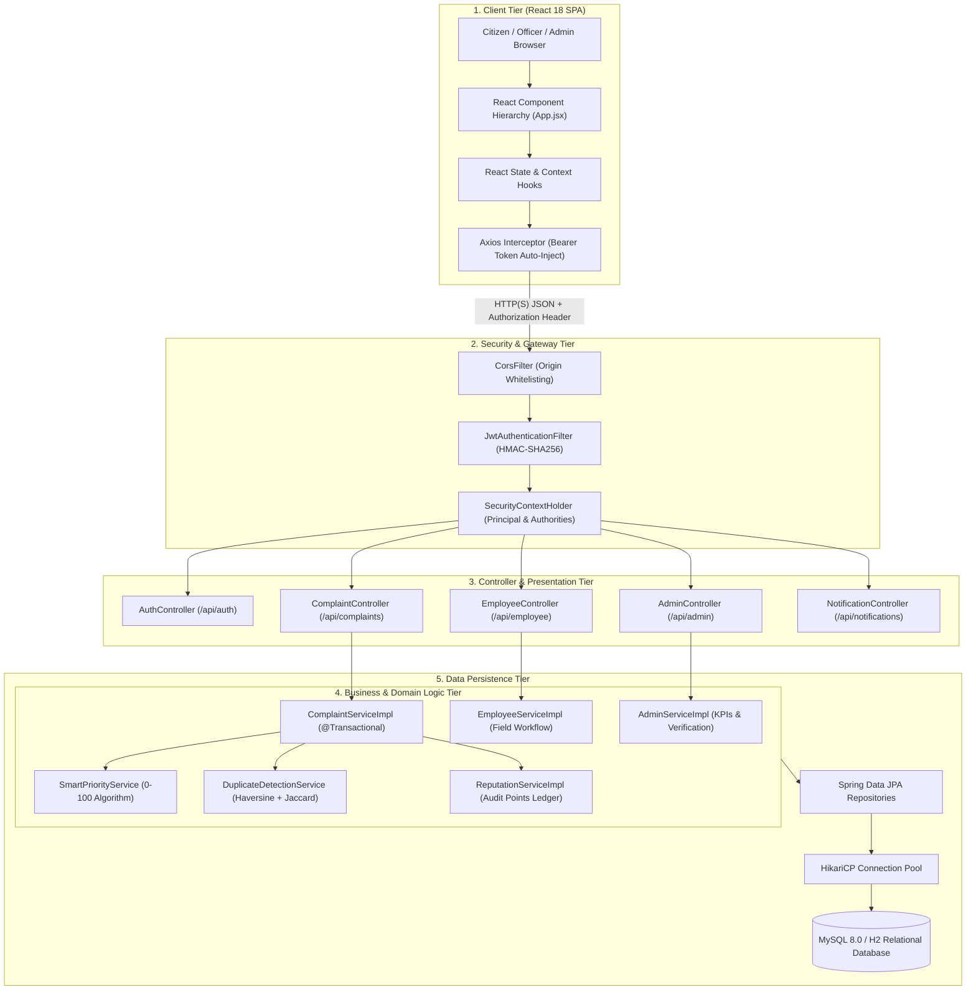
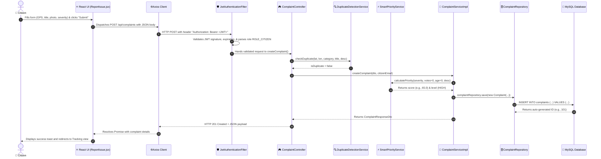
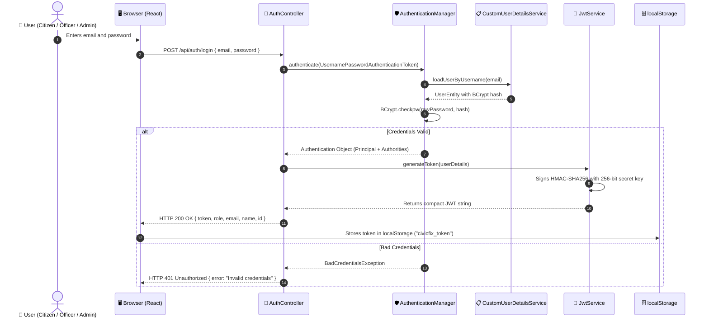
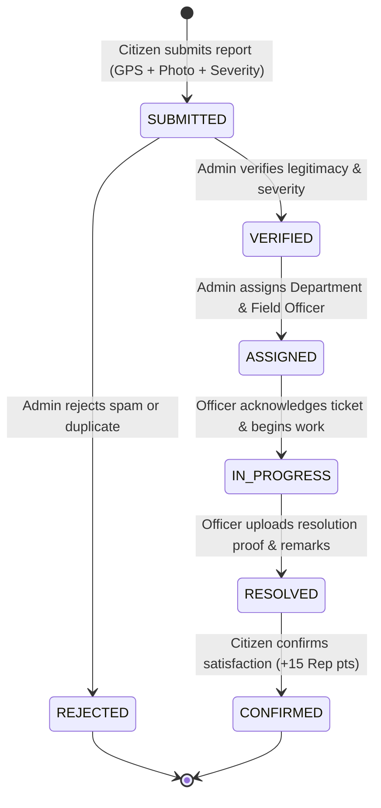
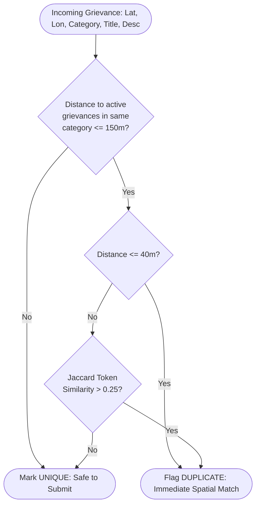

# 🏛️ CivicFix — Comprehensive System Architecture & Engineering Design

This document details the architectural principles, component interactions, security flows, algorithmic designs, and state machines underlying the **CivicFix Smart Civic Issue Reporting & Resolution Platform**.

---

## 1. High-Level Architectural Pattern

CivicFix is designed following a **decoupled, multi-tier client-server architecture** with a clear separation of concerns:
1. **Client Tier**: Single Page Application (SPA) powered by React 18, React Router DOM, and Vite.
2. **Security & API Gateway Tier**: Spring Security 6 filter chain executing stateless JWT extraction, signature validation, and RBAC authorization.
3. **Application & Controller Tier**: Spring MVC REST Controllers exposing versioned JSON endpoints.
4. **Domain & Service Tier**: Business logic encapsulating domain validation, mathematical priority calculation, geospatial duplicate clustering, and gamified reputation auditing.
5. **Data Persistence Tier**: Spring Data JPA and Hibernate ORM interacting with an ACID-compliant relational database (MySQL 8.0 in production, in-memory H2 for rapid testing) managed via HikariCP connection pooling.



---

## 2. End-to-End Request Lifecycle

Tracing a citizen reporting a civic issue from the browser click to database commit and back:



---

## 3. Stateless JWT Authentication Flow

CivicFix avoids server-side session state (`HttpSession`), enabling horizontal scalability without sticky sessions:



### JWT Anatomy in CivicFix
1. **Header**: `{"alg": "HS256", "typ": "JWT"}`
2. **Payload**:
   - `sub`: User email (`citizen@civicfix.gov`)
   - `role`: Granted authority (`ROLE_CITIZEN`)
   - `iat`: Epoch timestamp of issuance
   - `exp`: Epoch timestamp of expiration (`iat + 86400000ms = 24h`)
3. **Signature**: `HMACSHA256(base64UrlEncode(header) + "." + base64UrlEncode(payload), secret)`

---

## 4. Role-Based Authorization Mechanism (RBAC)

Spring Security 6 inspects authorities extracted from the JWT token and enforces permissions at the gateway level:

```java
@Bean
public SecurityFilterChain securityFilterChain(HttpSecurity http) throws Exception {
    return http
        .csrf(csrf -> csrf.disable())
        .sessionManagement(s -> s.sessionCreationPolicy(SessionCreationPolicy.STATELESS))
        .authorizeHttpRequests(auth -> auth
            // Public Endpoints
            .requestMatchers("/api/health", "/api/auth/**", "/uploads/**").permitAll()
            .requestMatchers(HttpMethod.GET, "/api/complaints/**", "/api/comments/**").permitAll()
            
            // Citizen Protected Endpoints
            .requestMatchers(HttpMethod.POST, "/api/complaints/**").hasRole("CITIZEN")
            .requestMatchers("/api/complaints/*/vote").hasRole("CITIZEN")
            .requestMatchers("/api/complaints/*/confirm-resolution").hasRole("CITIZEN")
            
            // Employee Protected Endpoints
            .requestMatchers("/api/employee/**").hasRole("EMPLOYEE")
            
            // Admin Protected Endpoints
            .requestMatchers("/api/admin/**").hasRole("ADMIN")
            
            // General Authenticated Endpoints
            .requestMatchers("/api/notifications/**", "/api/reputation/**").authenticated()
            .anyRequest().authenticated()
        )
        .addFilterBefore(jwtAuthFilter, UsernamePasswordAuthenticationFilter.class)
        .build();
}
```

---

## 5. Complaint Lifecycle State Machine

A civic grievance in CivicFix moves strictly through audited, deterministic states:



### State Transitions Table

| Current Status | Next Status | Triggering Actor | Pre-Conditions & Actions |
| :--- | :--- | :--- | :--- |
| *None* | `SUBMITTED` | `CITIZEN` | GPS location, category, severity provided. Dynamic priority score calculated. |
| `SUBMITTED` | `VERIFIED` | `ADMIN` | Admin validates issue. May adjust severity or category. |
| `SUBMITTED` | `REJECTED` | `ADMIN` | Marked invalid/spam. Deducts reputation points from citizen if abusive. |
| `VERIFIED` | `ASSIGNED` | `ADMIN` | Department ID and Field Officer ID assigned with deadline. |
| `ASSIGNED` | `IN_PROGRESS` | `EMPLOYEE` | Assigned officer starts work. Estimated resolution time provided. |
| `IN_PROGRESS` | `RESOLVED` | `EMPLOYEE` | Resolution proof image URL and resolution remarks are mandatory. |
| `RESOLVED` | `CONFIRMED` | `CITIZEN` | Citizen marks satisfied. Citizen reputation credited (+15 points). |

---

## 6. Smart Algorithms Deep Dive

### 6.1 Dynamic Smart Priority Engine (`SmartPriorityService.java`)
Grievance queues in legacy systems suffer from the **"First In, Ignored First"** problem. CivicFix continuously calculates priority dynamically using 4 orthogonal factors:

$$P = S_{base} + V_{boost} + A_{escalation} + K_{bonus}$$

Where:
- **Base Severity ($S_{base}$)**: Derived directly from the citizen/admin rating:
  $$S_{base} = \text{severity} \times 15.0 \implies [15.0, 75.0]$$
- **Community Vote Boost ($V_{boost}$)**: Crowdsourced confirmation from neighbors:
  $$V_{boost} = \min(\text{votes} \times 2.0, 10.0)$$
- **Aging Escalation ($A_{escalation}$)**: Daily grievance aging prevents neglected issues from being buried:
  $$A_{escalation} = \min\left(\left\lfloor\frac{t_{now} - t_{created}}{86400000}\right\rfloor \times 1.0, 10.0\right)$$
- **Urgent Safety Keyword Bonus ($K_{bonus}$)**: Scans title and description for hazard terms:
  $$K_{bonus} = \begin{cases} 5.0 & \text{if contains } \{\text{"danger", "spark", "collapse", "emergency", "fire", "burst", "overflow"}\} \\ 0.0 & \text{otherwise} \end{cases}$$

The final bounded score $P \in [0.0, 100.0]$ is categorized into distinct SLA tiers:
$$\text{Level} = \begin{cases} 
\text{CRITICAL} & P \ge 85.0 \\
\text{HIGH} & 65.0 \le P < 85.0 \\
\text{MEDIUM} & 35.0 \le P < 65.0 \\
\text{LOW} & P < 35.0
\end{cases}$$

---

### 6.2 Geospatial Duplicate Detection Engine (`DuplicateDetectionService.java`)
CivicFix eliminates duplicate municipal tickets filed by neighbors for the same issue through a two-stage filter:



#### Mathematical Formulas
1. **Haversine Distance**:
   $$d = 2 R \arcsin\left(\sqrt{\sin^2\left(\frac{\Delta \phi}{2}\right) + \cos \phi_1 \cos \phi_2 \sin^2\left(\frac{\Delta \lambda}{2}\right)}\right)$$
   Where $R = 6,371,000\text{ m}$, $\phi$ is latitude in radians, and $\lambda$ is longitude in radians.

2. **Jaccard Token Similarity**:
   $$J(A, B) = \frac{|A \cap B|}{|A \cup B|}$$
   Text is tokenized into lower-case alphanumeric word sets. Stopwords are naturally handled by relative set intersection.

---

## 7. Global Error Handling & Problem Details (RFC 7807)

CivicFix centralizes error handling using `@RestControllerAdvice` in [GlobalExceptionHandler.java](file:///c:/Users/Administrator/Documents/CivicFix/backend/civicfix-backend/src/main/java/com/civicfix/exception/GlobalExceptionHandler.java), returning consistent JSON envelopes:

```json
{
  "timestamp": "2026-09-19T02:20:00.000+00:00",
  "status": 409,
  "error": "Conflict",
  "message": "You have already upvoted this complaint",
  "path": "/api/complaints/42/vote"
}
```

### Handled Exception Hierarchy:
- `ResourceNotFoundException` $\implies$ `404 Not Found`
- `DuplicateVoteException` $\implies$ `409 Conflict`
- `MethodArgumentNotValidException` (Bean Validation) $\implies$ `400 Bad Request` with field-level map
- `BadCredentialsException` $\implies$ `401 Unauthorized`
- `AccessDeniedException` $\implies$ `403 Forbidden`
- `Exception` (fallback unhandled) $\implies$ `500 Internal Server Error`

---

## 8. Layered Package Architecture

The Java backend strictly enforces the **Ports and Adapters / Layered Architectural Pattern**:

```text
com.civicfix/
├── config/             # Spring beans, WebMvc, DataInitializer seeders
├── controller/         # REST Controllers (Input validation, HTTP mappings)
├── dto/                # Data Transfer Objects (Strongly typed payloads)
├── entity/             # JPA Entities (Relational mapping, table definitions)
├── exception/          # Custom runtime exceptions & @RestControllerAdvice
├── repository/         # Spring Data JPA interfaces (Native queries, derived finders)
├── security/           # JWT Filter, CustomUserDetailsService, SecurityFilterChain
└── service/            # Core business contracts
    └── impl/           # Concrete service implementations with @Transactional
```
