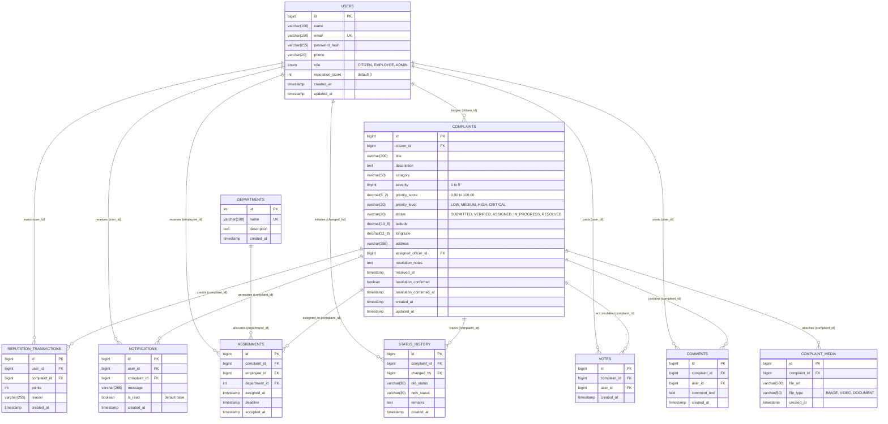

# 🗄️ CivicFix — Relational Database Architecture & Data Dictionary

This document specifies the complete relational schema, normalization, data dictionary, indexing strategy, and integrity rules for the **CivicFix Smart Civic Issue Reporting & Resolution Platform**.

---

## 1. Schema Overview & Normalization

The CivicFix relational model consists of **10 specialized tables** normalized to **Third Normal Form (3NF)**:
1. `users` (Central account management for Citizens, Employees, and Administrators)
2. `departments` (Municipal administrative divisions, e.g., Roads, Water, Sanitation)
3. `complaints` (Core civic grievance entity)
4. `complaint_media` (Photographic and document attachments)
5. `comments` (Two-way citizen-official discussion threads)
6. `votes` (Crowdsourced grievance upvoting)
7. `assignments` (Official department and field officer task delegation)
8. `status_history` (Immutable audit trail of state transitions)
9. `notifications` (Real-time in-app alerts and announcements)
10. `reputation_transactions` (Itemized civic reputation credit/debit ledger)

---

## 2. Entity-Relationship Diagram (Mermaid ER)



---

## 3. Comprehensive Data Dictionary (All 10 Tables)

### 3.1 Table: `users`
Central user registry for all authentication roles.
| Column | Data Type | Constraints | Description |
| :--- | :--- | :--- | :--- |
| `id` | `BIGINT` | `PK`, `AUTO_INCREMENT` | Unique identifier for user |
| `name` | `VARCHAR(100)` | `NOT NULL` | Full legal or display name |
| `email` | `VARCHAR(150)` | `NOT NULL`, `UNIQUE` | Unique email for login & JWT identity |
| `password_hash` | `VARCHAR(255)` | `NOT NULL` | BCrypt-hashed password (cost factor 10) |
| `phone` | `VARCHAR(20)` | `NULL` | Optional mobile contact number |
| `role` | `VARCHAR(20)` | `NOT NULL` | Security role: `CITIZEN`, `EMPLOYEE`, `ADMIN` |
| `reputation_score` | `INT` | `NOT NULL`, `DEFAULT 0` | Gamified civic score |
| `created_at` | `TIMESTAMP` | `NOT NULL`, `DEFAULT CURRENT_TIMESTAMP` | Registration date |
| `updated_at` | `TIMESTAMP` | `NOT NULL`, `ON UPDATE CURRENT_TIMESTAMP` | Last profile modification |

---

### 3.2 Table: `departments`
Municipal administrative divisions handling field redressal.
| Column | Data Type | Constraints | Description |
| :--- | :--- | :--- | :--- |
| `id` | `INT` | `PK`, `AUTO_INCREMENT` | Unique department code |
| `name` | `VARCHAR(100)` | `NOT NULL`, `UNIQUE` | Division name (e.g., Roads & Traffic) |
| `description` | `TEXT` | `NULL` | Scope of departmental responsibility |
| `created_at` | `TIMESTAMP` | `NOT NULL`, `DEFAULT CURRENT_TIMESTAMP` | Record creation date |

---

### 3.3 Table: `complaints`
Primary operational table representing lodged civic tickets.
| Column | Data Type | Constraints | Description |
| :--- | :--- | :--- | :--- |
| `id` | `BIGINT` | `PK`, `AUTO_INCREMENT` | Unique complaint tracking number |
| `citizen_id` | `BIGINT` | `NOT NULL`, `FK(users.id)` | Submitting citizen |
| `title` | `VARCHAR(200)` | `NOT NULL` | Concise issue summary |
| `description` | `TEXT` | `NOT NULL` | Detailed description of the problem |
| `category` | `VARCHAR(50)` | `NOT NULL` | Roads, Sanitation, Water, Electricity, etc. |
| `severity` | `TINYINT` | `NOT NULL`, `CHECK(1-5)` | Severity rating (1=Trivial, 5=Hazard) |
| `priority_score` | `DECIMAL(5,2)` | `NOT NULL`, `DEFAULT 0.00` | Automated algorithmic priority (0-100) |
| `priority_level` | `VARCHAR(20)` | `NOT NULL` | `LOW`, `MEDIUM`, `HIGH`, `CRITICAL` |
| `status` | `VARCHAR(20)` | `NOT NULL` | `SUBMITTED`, `VERIFIED`, `ASSIGNED`, `IN_PROGRESS`, `RESOLVED` |
| `latitude` | `DECIMAL(10,8)` | `NOT NULL` | GPS WGS84 Latitude coordinate |
| `longitude` | `DECIMAL(11,8)` | `NOT NULL` | GPS WGS84 Longitude coordinate |
| `address` | `VARCHAR(255)` | `NOT NULL` | Physical street / landmark address |
| `assigned_officer_id` | `BIGINT` | `NULL`, `FK(users.id)` | Field employee responsible for work |
| `resolution_notes` | `TEXT` | `NULL` | Remarks submitted by officer upon fix |
| `resolved_at` | `TIMESTAMP` | `NULL` | Exact completion timestamp |
| `resolution_confirmed` | `BOOLEAN` | `DEFAULT FALSE` | Citizen satisfaction sign-off |
| `resolution_confirmed_at` | `TIMESTAMP` | `NULL` | Timestamp citizen confirmed satisfaction |
| `created_at` | `TIMESTAMP` | `NOT NULL`, `DEFAULT CURRENT_TIMESTAMP` | Ticket lodgement timestamp |
| `updated_at` | `TIMESTAMP` | `NOT NULL`, `ON UPDATE CURRENT_TIMESTAMP` | Last status update |

---

### 3.4 Table: `complaint_media`
Media evidence uploaded during reporting or resolution.
| Column | Data Type | Constraints | Description |
| :--- | :--- | :--- | :--- |
| `id` | `BIGINT` | `PK`, `AUTO_INCREMENT` | Unique media item ID |
| `complaint_id` | `BIGINT` | `NOT NULL`, `FK(complaints.id)` | Associated complaint |
| `file_url` | `VARCHAR(500)` | `NOT NULL` | Storage URL or relative file path |
| `file_type` | `VARCHAR(50)` | `NOT NULL` | `IMAGE`, `VIDEO`, `DOCUMENT` |
| `created_at` | `TIMESTAMP` | `NOT NULL`, `DEFAULT CURRENT_TIMESTAMP` | Upload timestamp |

---

### 3.5 Table: `comments`
Public dialogue and updates between citizens and administrators.
| Column | Data Type | Constraints | Description |
| :--- | :--- | :--- | :--- |
| `id` | `BIGINT` | `PK`, `AUTO_INCREMENT` | Unique comment ID |
| `complaint_id` | `BIGINT` | `NOT NULL`, `FK(complaints.id)` | Associated complaint |
| `user_id` | `BIGINT` | `NOT NULL`, `FK(users.id)` | Comment author |
| `comment_text` | `TEXT` | `NOT NULL` | Comment body |
| `created_at` | `TIMESTAMP` | `NOT NULL`, `DEFAULT CURRENT_TIMESTAMP` | Timestamp posted |

---

### 3.6 Table: `votes`
Crowdsourced community endorsements.
| Column | Data Type | Constraints | Description |
| :--- | :--- | :--- | :--- |
| `id` | `BIGINT` | `PK`, `AUTO_INCREMENT` | Unique vote record ID |
| `complaint_id` | `BIGINT` | `NOT NULL`, `FK(complaints.id)` | Complaint receiving upvote |
| `user_id` | `BIGINT` | `NOT NULL`, `FK(users.id)` | Citizen casting upvote |
| `created_at` | `TIMESTAMP` | `NOT NULL`, `DEFAULT CURRENT_TIMESTAMP` | Timestamp vote cast |

*Enforced constraint: `UNIQUE KEY uk_vote_user_complaint (complaint_id, user_id)` guarantees one upvote per citizen per ticket.*

---

### 3.7 Table: `assignments`
Official departmental dispatches.
| Column | Data Type | Constraints | Description |
| :--- | :--- | :--- | :--- |
| `id` | `BIGINT` | `PK`, `AUTO_INCREMENT` | Unique assignment record ID |
| `complaint_id` | `BIGINT` | `NOT NULL`, `FK(complaints.id)` | Assigned complaint |
| `employee_id` | `BIGINT` | `NOT NULL`, `FK(users.id)` | Delegated field officer |
| `department_id` | `INT` | `NOT NULL`, `FK(departments.id)` | Responsible municipal department |
| `assigned_at` | `TIMESTAMP` | `NOT NULL`, `DEFAULT CURRENT_TIMESTAMP` | Delegation date |
| `deadline` | `TIMESTAMP` | `NULL` | Target resolution SLA deadline |
| `accepted_at` | `TIMESTAMP` | `NULL` | Timestamp officer acknowledged |

---

### 3.8 Table: `status_history`
Immutable chronological audit log for regulatory compliance.
| Column | Data Type | Constraints | Description |
| :--- | :--- | :--- | :--- |
| `id` | `BIGINT` | `PK`, `AUTO_INCREMENT` | Unique audit entry ID |
| `complaint_id` | `BIGINT` | `NOT NULL`, `FK(complaints.id)` | Target complaint |
| `changed_by` | `BIGINT` | `NOT NULL`, `FK(users.id)` | Actor who triggered transition |
| `old_status` | `VARCHAR(30)` | `NOT NULL` | Previous status state |
| `new_status` | `VARCHAR(30)` | `NOT NULL` | Resulting status state |
| `remarks` | `TEXT` | `NULL` | Explanation / officer notes |
| `created_at` | `TIMESTAMP` | `NOT NULL`, `DEFAULT CURRENT_TIMESTAMP` | Audit timestamp |

---

### 3.9 Table: `notifications`
In-app user notification alerts.
| Column | Data Type | Constraints | Description |
| :--- | :--- | :--- | :--- |
| `id` | `BIGINT` | `PK`, `AUTO_INCREMENT` | Unique notification ID |
| `user_id` | `BIGINT` | `NOT NULL`, `FK(users.id)` | Recipient user |
| `complaint_id` | `BIGINT` | `NULL`, `FK(complaints.id)` | Related complaint reference |
| `message` | `VARCHAR(255)` | `NOT NULL` | Notification headline |
| `is_read` | `BOOLEAN` | `NOT NULL`, `DEFAULT FALSE` | Read / unread status indicator |
| `created_at` | `TIMESTAMP` | `NOT NULL`, `DEFAULT CURRENT_TIMESTAMP` | Dispatch timestamp |

---

### 3.10 Table: `reputation_transactions`
Transparent gamification ledger.
| Column | Data Type | Constraints | Description |
| :--- | :--- | :--- | :--- |
| `id` | `BIGINT` | `PK`, `AUTO_INCREMENT` | Unique transaction ID |
| `user_id` | `BIGINT` | `NOT NULL`, `FK(users.id)` | Beneficiary citizen |
| `complaint_id` | `BIGINT` | `NULL`, `FK(complaints.id)` | Grievance context |
| `points` | `INT` | `NOT NULL` | Delta score (+10, +15, -20) |
| `reason` | `VARCHAR(255)` | `NOT NULL` | Transaction memo |
| `created_at` | `TIMESTAMP` | `NOT NULL`, `DEFAULT CURRENT_TIMESTAMP` | Credit timestamp |

---

## 4. Indexing Strategy & Performance Rationale

CivicFix executes complex filtering, geospatial clustering, and priority sorting. The database schema includes targeted B-Tree indexes:

```sql
-- 1. Fast Priority Sorting for Dashboards (O(log N) rather than O(N log N) full table scan)
CREATE INDEX idx_complaint_priority ON complaints(priority_score DESC);

-- 2. Geospatial Proximity Clustering for Duplicate Detection
CREATE INDEX idx_complaint_geo ON complaints(latitude, longitude);

-- 3. Departmental & Lifecycle Filtering
CREATE INDEX idx_complaint_status ON complaints(status);
CREATE INDEX idx_complaint_category ON complaints(category);

-- 4. Fast Citizen Dashboard Lookups
CREATE INDEX idx_complaint_citizen ON complaints(citizen_id);

-- 5. Field Officer Queue Filtering
CREATE INDEX idx_complaint_officer ON complaints(assigned_officer_id);

-- 6. Unread User Notification Lookups
CREATE INDEX idx_notification_user ON notifications(user_id, is_read);
```

---

## 5. Soft Delete vs Hard Delete Strategy

For civic governance and anti-corruption auditing, complaints and state histories **must never be physically deleted** (`HARD DELETE` is strictly forbidden). 
- If a ticket is identified as spam or abusive, it is transitioned to status `REJECTED` with an audit note by an administrator.
- Child tables (`status_history`, `reputation_transactions`) retain the complete lineage forever.

---

## 6. Production Database Recommendations

1. **Storage Engine**: Use **InnoDB** for all tables to guarantee ACID transactions, row-level locking, and foreign key integrity.
2. **Character Set**: Use `utf8mb4` with collation `utf8mb4_unicode_ci` to support multilingual civic descriptions and emoji markers.
3. **Connection Pooling**: Configure HikariCP with:
   - `maximum-pool-size: 20`
   - `minimum-idle: 5`
   - `idle-timeout: 300000` (5 minutes)
   - `connection-timeout: 20000` (20 seconds)
4. **Automated Backups**: Daily binary log incremental backups + weekly full snapshot dumps stored in an offsite S3-compatible bucket.
