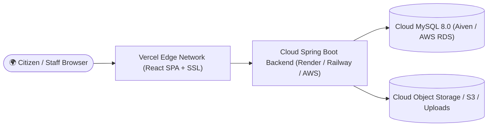

# 🚀 CivicFix — Complete Production Deployment Guide

This guide provides end-to-end instructions for deploying the **CivicFix Smart Civic Issue Reporting & Resolution Platform** to cloud hosting platforms with zero downtime, automated CI/CD pipelines, SSL certificates, and managed databases.

---

## 1. Production Architecture Overview



---

## 2. Frontend Deployment (Vercel / Netlify)

### Option A: Deploying on Vercel (Recommended)
CivicFix frontend includes a pre-configured [vercel.json](file:///c:/Users/Administrator/Documents/CivicFix/frontend/vercel.json) that automatically handles Single Page Application (SPA) HTML5 history routing redirects.

1. Push your code to a GitHub repository:
   ```bash
   git push origin master
   ```
2. Log in to [Vercel Dashboard](https://vercel.com) and click **"Add New Project"**.
3. Import your GitHub repository.
4. Configure the Project Settings:
   - **Framework Preset**: `Vite`
   - **Root Directory**: `frontend`
   - **Build Command**: `npm run build`
   - **Output Directory**: `dist`
   - **Install Command**: `npm install`
5. Add Environment Variables:
   - `VITE_API_BASE_URL`: `https://civicfix-backend.onrender.com/api`
6. Click **Deploy**. Vercel will provision an SSL-secured URL (e.g., `https://civicfix.vercel.app`).

### Option B: Deploying on Netlify
Create `frontend/public/_redirects`:
```text
/*    /index.html   200
```
Build command: `npm run build`, publish directory: `dist`.

---

## 3. Backend Deployment (Render / Railway / AWS EC2)

### Option A: Deploying on Render (Free / Low Cost Tier)
Render supports Docker or native Maven builds:
1. Log in to [Render](https://render.com) and click **"New Web Service"**.
2. Connect your GitHub repository.
3. Select **Docker** environment:
   - **Dockerfile Path**: `backend/civicfix-backend/Dockerfile`
   - **Docker Context**: `backend/civicfix-backend`
4. Set Environment Variables:
   ```properties
   SPRING_PROFILES_ACTIVE=prod
   PORT=8081
   DB_HOST=your-mysql-host.aivencloud.com
   DB_PORT=12345
   DB_NAME=civicfix_db
   DB_USER=avnadmin
   DB_PASSWORD=YOUR_STRONG_PASSWORD
   JWT_SECRET=404E635266556A586E3272357538782F413F4428472B4B6250645367566B5970
   JWT_EXPIRATION_MS=86400000
   CORS_ALLOWED_ORIGINS=https://civicfix.vercel.app
   ```
5. Click **Create Web Service**.

### Option B: Deploying on Ubuntu AWS EC2 (Enterprise Production)
1. Launch an `t3.small` Ubuntu 22.04 LTS instance with Security Group opening ports `80`, `443`, and `22`.
2. Install OpenJDK 21 and Nginx:
   ```bash
   sudo apt update && sudo apt install -y openjdk-21-jre nginx certbot python3-certbot-nginx
   ```
3. Build the backend JAR locally:
   ```bash
   cd backend/civicfix-backend
   .\mvnw.cmd clean package -DskipTests
   ```
4. Transfer `target/civicfix-backend-0.0.1-SNAPSHOT.jar` to `/opt/civicfix/` on EC2.
5. Create a systemd service `/etc/systemd/system/civicfix.service`:
   ```ini
   [Unit]
   Description=CivicFix Backend Spring Boot Service
   After=syslog.target network.target

   [Service]
   User=ubuntu
   WorkingDirectory=/opt/civicfix
   ExecStart=/usr/bin/java -jar -Dspring.profiles.active=prod /opt/civicfix/civicfix-backend.jar
   SuccessExitStatus=143
   Restart=always
   RestartSec=10

   [Install]
   WantedBy=multi-user.target
   ```
6. Start service:
   ```bash
   sudo systemctl daemon-reload
   sudo systemctl enable civicfix
   sudo systemctl start civicfix
   ```

---

## 4. Cloud MySQL Database Setup (Aiven / AWS RDS)

### Using Aiven Cloud MySQL (Generous Free/Trial Tier)
1. Sign up on [Aiven.io](https://aiven.io).
2. Create a new **MySQL 8.0** service (Free tier or Startup-4).
3. Under service overview, retrieve:
   - **Host**: `mysql-XXXX.aivencloud.com`
   - **Port**: `XXXXX`
   - **User**: `avnadmin`
   - **Password**: `******`
4. Connect via MySQL Workbench or command line and execute the production schema:
   ```bash
   mysql -h mysql-XXXX.aivencloud.com -P XXXXX -u avnadmin -p < database/schema.sql
   ```
5. Insert baseline lookup rows:
   ```bash
   mysql -h mysql-XXXX.aivencloud.com -P XXXXX -u avnadmin -p < database/seed-data.sql
   ```

---

## 5. Domain, Reverse Proxy & SSL Setup

### Nginx Reverse Proxy Configuration on EC2 (`/etc/nginx/sites-available/civicfix`)
```nginx
server {
    server_name api.civicfix.gov;

    location / {
        proxy_pass http://127.0.0.1:8081;
        proxy_set_header Host $host;
        proxy_set_header X-Real-IP $remote_addr;
        proxy_set_header X-Forwarded-For $proxy_add_x_forwarded_for;
        proxy_set_header X-Forwarded-Proto $scheme;
    }

    location /uploads/ {
        alias /opt/civicfix/uploads/;
        expires 30d;
        add_header Cache-Control "public, no-transform";
    }
}
```
Obtain free trusted Let's Encrypt SSL certificate:
```bash
sudo certbot --nginx -d api.civicfix.gov
```

---

## 6. Continuous Integration & Continuous Deployment (GitHub Actions)

Create `.github/workflows/ci-cd.yml`:
```yaml
name: CivicFix CI/CD Pipeline

on:
  push:
    branches: [ "master" ]
  pull_request:
    branches: [ "master" ]

jobs:
  backend-build-test:
    name: Backend Test & Package
    runs-on: ubuntu-latest
    steps:
      - uses: actions/checkout@v4
      - name: Set up JDK 21
        uses: actions/setup-java@v4
        with:
          java-version: '21'
          distribution: 'temurin'
          cache: maven
      - name: Run Backend Tests
        run: |
          cd backend/civicfix-backend
          mvn clean test
      - name: Build Production JAR
        run: |
          cd backend/civicfix-backend
          mvn package -DskipTests

  frontend-build:
    name: Frontend Lint & Build
    runs-on: ubuntu-latest
    steps:
      - uses: actions/checkout@v4
      - name: Set up Node.js 20
        uses: actions/setup-node@v4
        with:
          node-version: '20'
          cache: 'npm'
          cache-dependency-path: frontend/package-lock.json
      - name: Install Dependencies
        run: |
          cd frontend
          npm ci
      - name: Build Vite Bundle
        run: |
          cd frontend
          npm run build
```

---

## 7. Monitoring, Logging & Backups

1. **Spring Boot Actuator**:
   Add `spring-boot-starter-actuator` to enable health endpoints (`/actuator/health`, `/actuator/metrics`).
2. **Log Rotation**:
   In production, pipe standard output to logrotate or AWS CloudWatch Logs.
3. **Database Automated Backups**:
   Schedule an automated cron job on your cloud database:
   ```bash
   mysqldump -u avnadmin -p civicfix_db | gzip > /backups/civicfix_$(date +\%F).sql.gz
   ```

---

## 8. Cloud Cost Estimation (Free / Low-Cost Tier)

| Service | Provider | Tier | Estimated Monthly Cost |
| :--- | :--- | :--- | :--- |
| **Frontend CDN** | Vercel / Netlify | Hobby / Free Tier | **$0.00 / month** |
| **Backend Web Service** | Render / Railway | Free / Starter ($5–$7) | **$0.00 – $7.00 / month** |
| **Cloud MySQL 8.0** | Aiven / PlanetScale | Developer Free Tier | **$0.00 / month** |
| **SSL Certificates** | Let's Encrypt / Vercel | Automated Wildcard | **$0.00 / month** |
| **DNS Domain Name** | Namecheap / Cloudflare | Custom `.org` or `.gov` | **$1.00 / month** ($12/year) |
| **Total Estimated Cost**| | | **$0.00 – $8.00 / month** |
