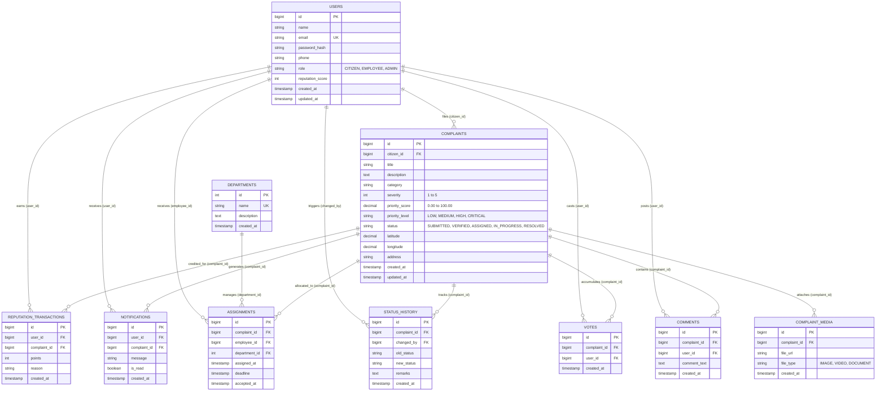

# CivicFix — Entity-Relationship (ER) Architecture

This document specifies the relational database schema and entity relationships for the **CivicFix Smart Civic Grievance Redressal Platform**.

---

## 1. Entity-Relationship (ER) Diagram

---

## 2. Table Cardinalities & Business Rules

1. **One Citizen $\rightarrow$ Many Complaints (1:N)**:
   - A registered citizen can lodge multiple complaints over time.
   - Each complaint belongs strictly to one citizen (`citizen_id`).
2. **One Complaint $\rightarrow$ Many Media Files (1:N)**:
   - A grievance can include multiple photos/videos (e.g., before and after repair).
3. **One Complaint $\rightarrow$ Many Comments (1:N)**:
   - Citizens and assigned municipal officers can hold discussions on a ticket.
4. **One User + One Complaint $\rightarrow$ One Vote (Composite Unique Key)**:
   - A citizen can upvote a complaint to show community urgency, but duplicate votes by the same user on the same complaint are forbidden by `UNIQUE KEY (complaint_id, user_id)`.
5. **One Department $\rightarrow$ Many Assignments (1:N)**:
   - A municipal department (e.g., Public Works) handles assignments across multiple complaints.
6. **One Complaint $\rightarrow$ Many Status History Entries (1:N)**:
   - Provides an immutable audit trail (`SUBMITTED` $\rightarrow$ `VERIFIED` $\rightarrow$ `ASSIGNED` $\rightarrow$ `IN_PROGRESS` $\rightarrow$ `RESOLVED`).

---

## 3. Database Normalization (1NF to 3NF)

- **1NF (First Normal Form)**: Every column holds atomic (indivisible) values. No repeating comma-separated lists of photos or comments (stored in `complaint_media` and `comments` child tables).
- **2NF (Second Normal Form)**: In 1NF and all non-key attributes are fully functionally dependent on the primary key (no partial dependencies).
- **3NF (Third Normal Form)**: In 2NF and no transitive dependencies. Department descriptions reside in `departments`, not duplicated across every complaint row.

---

## 4. Smart Priority & Duplicate Detection Architecture

- **Smart Priority Indexing**:
  - `INDEX idx_complaint_priority (priority_score DESC)` allows $O(1)$ dashboard sorting of the most urgent issues.
  - Factors: `severity` (1-5), `votes` count (crowdsourced urgency), and `DATEDIFF(CURRENT_TIMESTAMP, created_at)` (pending duration).
- **Geospatial & Category Clustering**:
  - `INDEX idx_complaint_geo (latitude, longitude)` combined with `category` enables spatial proximity calculation to flag duplicate reports filed by multiple neighbors for the same pothole or broken streetlight.
